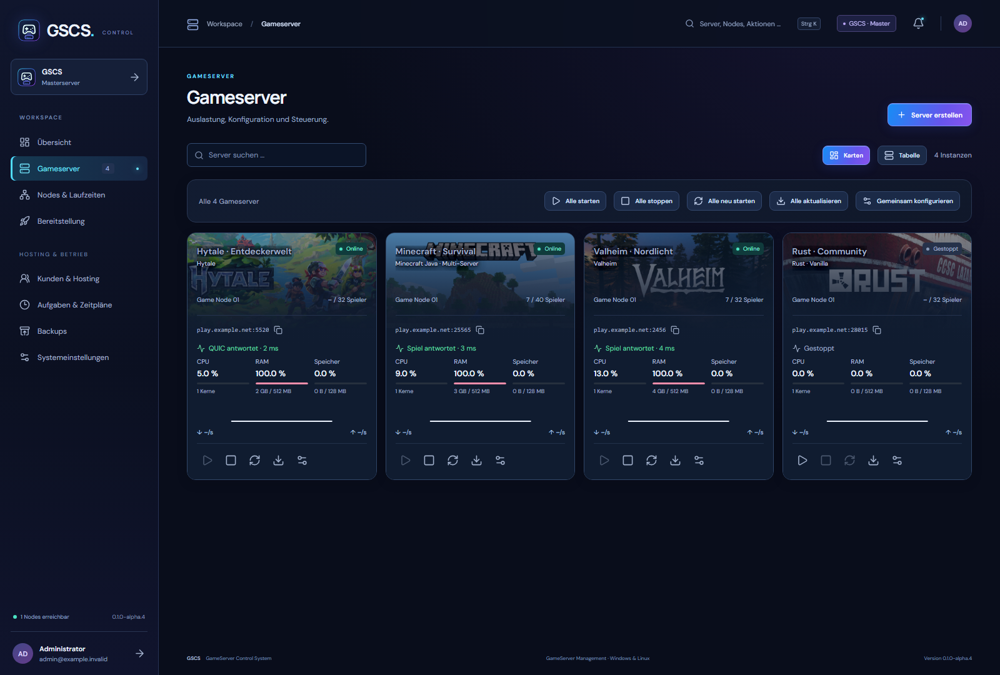
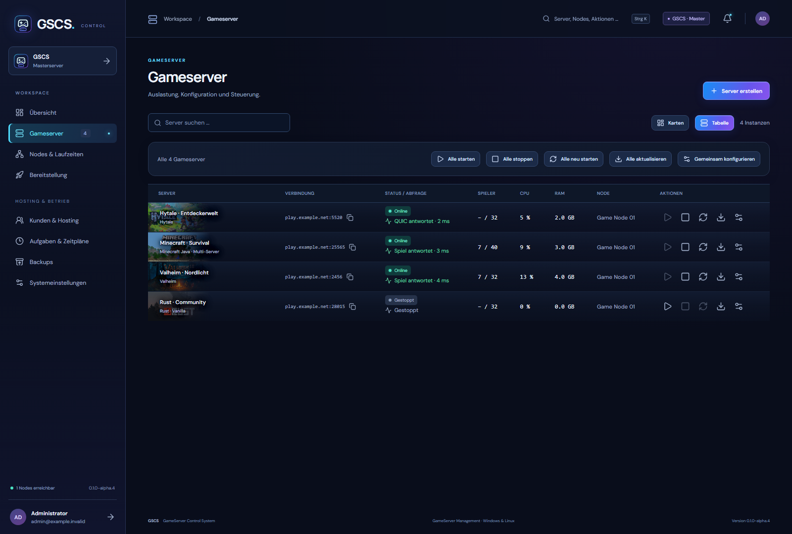
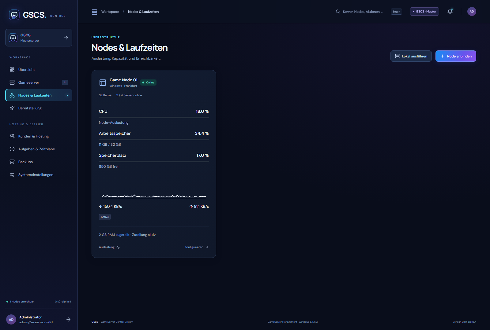
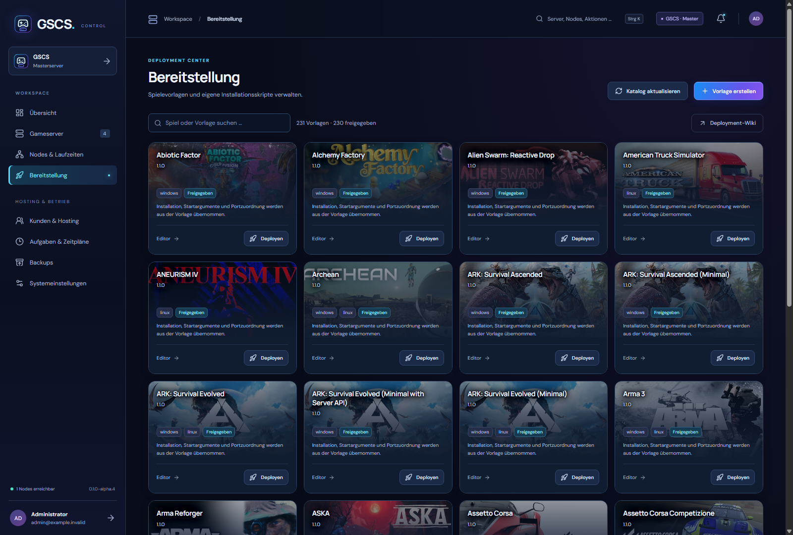
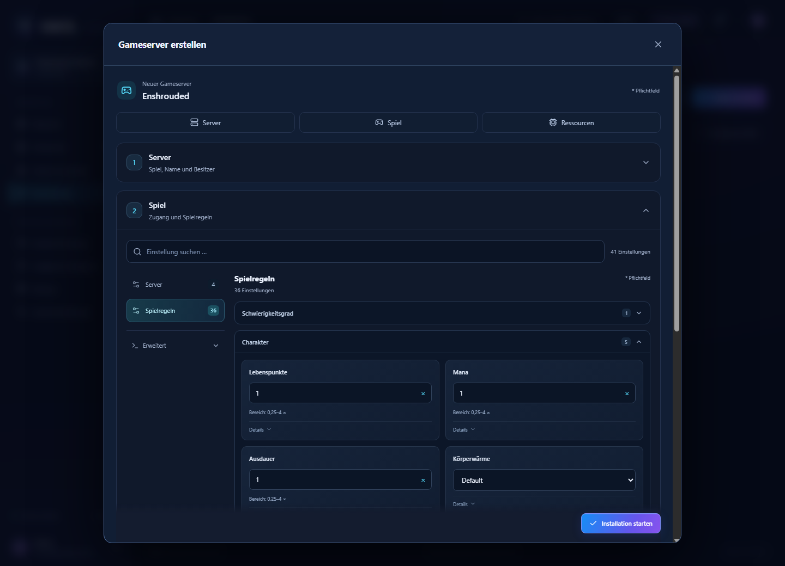

<h1 align="center">GSCS · GameServer Control System</h1>

Deine Gameserver. Ein Webinterface.

<a href="https://github.com/ZUMBYTE-AppSolution/gscs-release/releases/tag/v0.1.0-alpha.9">Herunterladen</a> · <a href="docs/START-HERE.md">Erste Schritte</a> · <a href="https://github.com/ZUMBYTE-AppSolution/gscs-deployment/wiki">Eigene Spielvorlagen</a> · <a href="https://www.zumbyte.de/support/">Support</a>

**GSCS** verwaltet Gameserver auf Windows- und Linux-Systemen über deinen Browser. Installiere Spiele aus dem Katalog, passe ihre Einstellungen an und behalte Status, Auslastung und Verbindungen im Blick. Ein Master verwaltet deine lokalen Server und zusätzliche Nodes. Für Kundenhosting stehen getrennte Zugänge, Ressourcenlimits und Bestellungen bereit.

**Aktuell: Alpha 9.** Windows x64, Linux x64/ARM64 und Docker x64. Die Laufzeiten für GSCS sind enthalten; ein SDK ist nicht erforderlich. Für SteamCMD und Wine/Proton wird x64 benötigt.

Kostenpflichtige GSCS-Lizenzen sind aktuell nicht erhältlich. Mit einem registrierten und bestätigten [Zumbyte-Konto](https://zumbyte.de/licenses/) kannst du im Einrichtungsassistenten eine **kostenlose Testlizenz für 90 Tage** aktivieren. Während der Alpha ist die Verlängerung um jeweils 90 Tage kostenlos. Ohne Lizenz steht ein Gameserver auf localhost zur Verfügung.

## Einblicke

| Kompakte Serverliste | Nodes und Laufzeiten |
|---|---|
|  |  |

Die Screenshots zeigen die Oberfläche mit Beispieldaten. Spielnamen und Bilder gehören ihren jeweiligen Rechteinhabern.

## Downloads

| Installation | Paket |
|---|---|
| Windows x64 · Webinterface und lokaler Node | [Master für Windows](https://github.com/ZUMBYTE-AppSolution/gscs-release/releases/download/v0.1.0-alpha.9/GSCS-0.1.0-alpha.9-master-win-x64.zip) |
| Linux x64 · Webinterface und lokaler Node | [Master für Linux x64](https://github.com/ZUMBYTE-AppSolution/gscs-release/releases/download/v0.1.0-alpha.9/GSCS-0.1.0-alpha.9-master-linux-x64.zip) |
| Linux ARM64 · Webinterface und lokaler Node | [Master für Linux ARM64](https://github.com/ZUMBYTE-AppSolution/gscs-release/releases/download/v0.1.0-alpha.9/GSCS-0.1.0-alpha.9-master-linux-arm64.zip) |
| Docker x64 | [Image-Archiv](https://github.com/ZUMBYTE-AppSolution/gscs-release/releases/download/v0.1.0-alpha.9/GSCS-0.1.0-alpha.9-docker-universal-linux-x64.tar.gz) · [Compose und Einrichtung](https://github.com/ZUMBYTE-AppSolution/gscs-release/releases/download/v0.1.0-alpha.9/GSCS-0.1.0-alpha.9-docker.zip) |
| Unraid | [Vorlage, Kanalwahl und Installer](https://github.com/ZUMBYTE-AppSolution/gscs-release/releases/download/v0.1.0-alpha.9/GSCS-0.1.0-alpha.9-unraid-tools.zip) |
| Weitere Nodes | [Node-Pakete für Windows und Linux](https://github.com/ZUMBYTE-AppSolution/gscs-release/releases/tag/v0.1.0-alpha.9) |

Unter Windows **start-master.cmd**, unter Linux **bash start-master.sh** ausführen und die Einrichtung im Browser abschließen. Die Dienstinstaller fragen nach Master oder Node, lokaler Ausführung und Datenbank. Zufällige Datenbank-Zugangsdaten werden hinterlegt und am Ende ausgegeben. [Installation und Paketwahl](docs/INSTALLATION.md).

Docker verwendet **ein gemeinsames Image** für Master, Node und isolierte Spielcontainer. Der Master enthält PostgreSQL. Für Unraid stehen Vorlage und Kanal-Dropdown für Alpha, Beta und Release bereit; noch nicht verfügbare Kanäle bleiben deaktiviert. Das Image-Archiv lässt sich ohne Registry-Konto laden. Private GHCR-Updates setzen einen freigeschalteten GitHub-Zugang voraus. [Unraid einrichten und aktualisieren](docs/UNRAID-UPDATES.md).

## Deine Server verwalten

| Bereich | Möglichkeiten |
|---|---|
| Spiele und Konfiguration | 231 Gameserver-Profile, nach Namen sortiert. Kategorisierte Einstellungen, SteamCMD, Workshop, Mods und automatisch erzeugte Startskripte. Eigene Startskripte bleiben bei Updates erhalten. |
| Steuerung | Start, Stopp, Neustart, Update und Konfiguration pro Server oder gemeinsam. Animierte Auftragsmeldungen bleiben auch über geöffneten Dialogen sichtbar. Konsole, RCON, Zeitpläne und Crash-Neustarts. |
| Nodes und Laufzeiten | Windows und Linux, native Prozesse, Docker, Wine, Proton und WSL. Node-Karten mit CPU, RAM, Speicher, Netzwerkraten und Kapazität. |
| Netzwerk | Freie Portwahl innerhalb der Node-Pools, TCP/UDP, Belegungsprüfung und atomare Reservierungen. UPnP mit Routerbestätigung, Erneuerung und Bereinigung. Spieladressen zum Kopieren und getrennte Prozess-/Spielabfragen. |
| Backups und Umzug | Verschlüsselte Sicherungen, geschützter Restore, externe S3-Kopien, Systemexport mit Datenbank und optionalen Dateien sowie Node-Umzug. |
| Eigene Vorlagen | Wizard und freier Editor, Konfigurationsfelder und Tabs, eigene GitHub-Kataloge und Freigabe geänderter Skripte. [Profil-Wiki](https://github.com/ZUMBYTE-AppSolution/gscs-deployment/wiki). |
| Benutzer und Hosting | Rollen, einzelne Serverfreigaben, Kundenkonten und Hostingpakete. Docker-Ressourcenlimits, Bestellungen und Zahlungsanbieter-Anbindungen. |
| Zugriff und Betrieb | 2FA, Passkeys, OIDC, API-Tokens, Auditprotokoll, Statusseite, Webhooks und Benachrichtigungen. |

Hytale hat einen geführten Anmeldedialog mit Link, Gerätecode und Bestätigungsanzeige. GSCS hält die Anbieteranmeldung aktuell und erstellt eigene Spielsitzungen. Updates werden über GSCS ausgeführt. [Hytale einrichten](docs/HYTALE.md) · [Ports und UPnP](docs/NETWORK.md) · [SteamGridDB einrichten](docs/ARTWORK.md).

## Neu in Alpha 9

- **Server entfernen** ist direkt im Serverfenster und in der Konfiguration erreichbar. Administratoren können Spieldateien behalten oder vollständig deinstallieren; der genaue Servername bestätigt die Auswahl.
- Fehlgeschlagene oder unterbrochene Entfernungen lassen sich mit derselben Auswahl erneut versuchen. Eintrag und Portzuweisungen bleiben bis zum erfolgreichen Abschluss erhalten. Verbliebene Spielprozesse lassen sich nach Namensbestätigung gezielt stoppen.
- Unter **Entfernte Server** lassen sich Einstellungen und Backupzugriff wieder aufnehmen. Der ursprüngliche Node erhält neue Ports aus seinen Pools; der Server bleibt gestoppt. Gelöschte Spieldateien werden anschließend aus einem Backup wiederhergestellt oder neu installiert.

[Versionshinweise zu Alpha 9](https://github.com/ZUMBYTE-AppSolution/gscs-release/releases/tag/v0.1.0-alpha.9) · [Entfernen und Wiederherstellen](docs/START-HERE.md#server-entfernen-und-wiederherstellen).

## Aus Alpha 8

- Die Konfiguration bietet Suche, Kategorien und Feldgruppen für Server, Spiel und Ressourcen. Schalter zeigen ihren Zustand direkt; Eingabefehler führen zum passenden Feld.
- Das Spielerlimit übernimmt Standardwert und Grenzen des jeweiligen Spiels. Unter Ressourcen lässt es sich beim Anlegen und später in der Serverkonfiguration ändern.
- Fehlende Wine- und Proton-Umgebungen werden vor dem Start automatisch angelegt. Auch beim Start aus einem Unterordner bleibt die Umgebung der Serverinstanz zugeordnet.
- Fehlende SteamCMD-Spielinformationen werden einmal automatisch neu geladen; anschließend wird die Installation oder das Update erneut versucht.
- Laufende oder fehlgeschlagene Installationen sperren den Serverstart. Eine Installation lässt sich bei gestopptem Server ausdrücklich wiederholen; Konfiguration und eigene Startskripte bleiben erhalten.

[Versionshinweise zu Alpha 8](https://github.com/ZUMBYTE-AppSolution/gscs-release/releases/tag/v0.1.0-alpha.8).

## Aus Alpha 7

- „Deployen“ öffnet den Bereitstellungsdialog sofort mit Ladeanzeige.
- GSCS lädt dafür nur die benötigten Formulardaten und verfügbaren Besitzer.
- Bei einem Ladefehler lässt sich der Abruf direkt wiederholen.
- Schließen und Vorlagenwechsel brechen den bisherigen Abruf ab. Verspätete Antworten überschreiben keine neuere Auswahl; während des Ladens bleibt die Installation gesperrt.

[Versionshinweise zu Alpha 7](https://github.com/ZUMBYTE-AppSolution/gscs-release/releases/tag/v0.1.0-alpha.7).

## Aus Alpha 6

- Gültige Dezimalwerte blockieren die Bereitstellung nicht mehr. Ganzzahlen, Grenzen und vorgegebene Schrittweiten werden weiter geprüft.
- Ungültige Eingaben öffnen ihren Tab und nennen Feld und Grund.
- Ausgeschaltete Schalter und leere Auswahlwerte werden beim Erstellen korrekt übernommen.
- Plattformspezifische Pflichtfelder passen zu Node und Laufzeit; ein Wechsel erhält eingegebene Werte.
- Statuswerte aktualisieren sich ohne kompletten Seitenneuaufbau. Spielbilder, Fokus und Eingaben bleiben erhalten; fehlende Bilder werden begrenzt erneut angefragt.
- Vorlagenübersichten werden für schnellere Folgeabrufe zwischengespeichert.

[Versionshinweise zu Alpha 6](https://github.com/ZUMBYTE-AppSolution/gscs-release/releases/tag/v0.1.0-alpha.6).

## Aus Alpha 5

- Docker übernimmt den neuen Programmstand auch bei gleicher Versionsnummer. Entscheidend sind die signierten Programmdateien des Images.
- Bestehende Alpha-4-Datenordner verwenden nach dem Update die neue Anwendung. Benutzer, Lizenzen, Einstellungen und Spieldateien bleiben erhalten.
- Wiederaufnahme und Startprüfung ordnen die Übernahme dem tatsächlichen Programmstand zu. Bei einem fehlgeschlagenen Start bleibt die Rückkehr zur vorherigen Anwendung und Datenbank möglich.
- Jeder Node ermittelt seine öffentliche IP im Hintergrund für die Spieladressen in Karten und Liste. Manuelle Adressen haben Vorrang; eine erkannte IP bestätigt keine Erreichbarkeit aus dem Internet.
- Der Browser lädt nach Updates die passenden Dateien des Webinterfaces. Spielbilder bleiben zwischengespeichert.
- Die Unraid-Vorlage stellt die Host-Portansicht auch bei eigenen Container-IP-Adressen über br0 schreibgeschützt bereit.
- Manuelle Ports werden sofort auf Poolgrenzen und Belegung geprüft. Gesperrtes Speichern wird im Dialog erklärt; eine erneute Prüfung erhält die eingegebenen Werte.

[Versionshinweise zu Alpha 5](https://github.com/ZUMBYTE-AppSolution/gscs-release/releases/tag/v0.1.0-alpha.5) · [Container auf Unraid aktualisieren](docs/UNRAID-UPDATES.md).

## Aus Alpha 4

- Portbereiche, Node-Daten und Bearbeitungsformulare speichern wieder zuverlässig; der Einrichtungsassistent lässt sich fortsetzen und erneut öffnen.
- Portwahl innerhalb des Pools einschließlich System-/Docker-Belegung und sicherer Änderung bestehender Zuweisungen.
- Echte UPnP-Freigaben für TCP und UDP mit Rückprüfung am Router.
- Spieladresse und tatsächliche Protokollabfrage in Karten und Liste, Einzel- und Sammelaktionen einschließlich Update mit vorheriger Sicherung.
- Status wird auch bei geöffneten Dialogen im Hintergrund aktualisiert; ungespeicherte Eingaben bleiben erhalten. Serveraktionen zeigen ihren Fortschritt bis zur Bestätigung oder zum Fehler.
- Spielbilder als Karten- und Listenhintergrund; SteamGridDB-Zuordnung über Steam-ID oder Spielname; Cache auf dem Master und im Browser. Langsame Bildquellen blockieren die Bedienung nicht.
- Native Linux-Starts ändern die Rechte bereits ausführbarer Systemprogramme und Java-Laufzeiten nicht mehr. Fehlende Ausführungsrechte werden nur in verwalteten Serververzeichnissen ergänzt.
- Korrigierte Lizenzaktivierung, Proton-Pfaderkennung und Hytale-Geräteanmeldung. Wartungsfenster lassen sich abschalten.
- Aktueller Katalog mit 231 Gameserver-Profilen und Unraid-Vorlage mit Kanalwahl.

[Versionshinweise zu Alpha 4](https://github.com/ZUMBYTE-AppSolution/gscs-release/releases/tag/v0.1.0-alpha.4) · [Vollständiger Funktionsstand](docs/FEATURES.md).

## Updates und Alpha-Stand

Vor einem Versions- oder Systemwechsel eine externe Sicherung und einen verschlüsselten Systemexport erstellen. Dienstinstallationen bereiten Updates im Webinterface vor; portable Pakete werden vollständig neu entpackt und mit dem vorhandenen Datenordner gestartet. Docker wird über ein neues Image mit denselben Datenordnern aktualisiert.

Release-Manifeste und Programmdateien sind mit RSA/SHA-256 signiert. Prüfsummen und der [öffentliche Prüfschlüssel](release-public.pem) werden mitgeliefert. Eine Windows-Authenticode-Signatur ist derzeit nicht enthalten.

Die Alpha wird weiter erprobt. Die enthaltenen Profile sind kein Startnachweis aller Spiele; Laufzeiten und Spielberechtigungen hängen vom jeweiligen Anbieter ab. Native ARM64-Ausgaben sind gebaut, aber noch nicht auf ARM64-Hardware geprüft. Dienstinstaller, WSL, längerer Spielbetrieb und produktive Zahlungsanbieter benötigen weitere Referenztests. Eine erfolgreiche Spielabfrage vom Node bestätigt keine Erreichbarkeit aus dem Internet. Der konkrete Prüfumfang steht im Release unter **VERIFICATION.md**.

## Hilfe und Lizenz

[Fehler melden](https://github.com/ZUMBYTE-AppSolution/gscs-release/issues) · [Support](https://www.zumbyte.de/support/) · [Deployment-Wiki](https://github.com/ZUMBYTE-AppSolution/gscs-deployment/wiki)

GSCS ist proprietäre Software von **Zumbyte - AppSolution**. Der Quellcode und die GHCR-Images sind privat; dieses Repository enthält die öffentlichen Installpakete, Vorlagen und Dokumentation. Lizenzen mitgelieferter Komponenten liegen in den Paketen. Es werden keine proprietären Spielserverdateien verteilt.

**[www.zumbyte.de](https://www.zumbyte.de/)** · [Datenschutz](https://www.zumbyte.de/datenschutz/) · [Impressum](https://www.zumbyte.de/impressum/)
